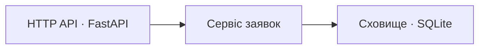
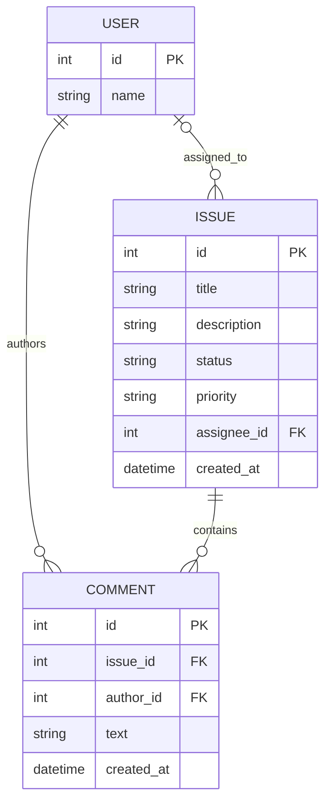

# Mini Issue Tracker — архітектура

Локальний сервіс на Python, FastAPI та SQLite. Для ЛР №3 заплановано pytest. Модель сутностей спирається на [контракт даних](requirements.md#контракт-даних).

## Схема компонентів

| Компонент | Відповідальність |
|---|---|
| HTTP API | Схеми перевіряють форму та типи вхідних даних. Маршрути передають валідований запит сервісу й перетворюють результат на HTTP-відповідь за [API-контрактом](api-contract.md). |
| Сервіс заявок | Бізнес-правила, перевірка наявності заявки, фільтри, часткове редагування, призначення, переходи статусів і коментарі. Сервіс визначає межу транзакції операції. |
| Сховище | Читання та запис у SQLite, транзакції, зовнішні ключі й стабільний порядок результатів. Використовує початковий довідник двох користувачів. |

У реалізації модуль schemas належить компоненту HTTP API, модуль service — сервісу заявок, а database — сховищу. Маршрути не дублюють бізнес-правил. Для JSON-помилок з API-контракту потрібні власні обробники FastAPI для RequestValidationError, помилок пошуку та конфлікту стану. Стандартна відповідь FastAPI з полем detail не відповідає обраному формату error; некоректний JSON і некоректні параметри запиту також перетворюються на визначену відповідь 422.

Для кожного з’єднання SQLite необхідно виконати `PRAGMA foreign_keys = ON` до початку транзакцій. Сервіс задає транзакційну межу, а database виконує commit лише після всіх перевірок; за відмови — rollback. Читання поточного стану й зміна мають бути в одній транзакції запису, наприклад BEGIN IMMEDIATE, щоб паралельний запит не змінив стан між перевіркою та UPDATE.

Для ЛР №4 точка підключення класифікатора — окрема операція рекомендації на рівні сервісу. Вона передає класифікатору копію дозволених даних заявки та повертає пораду. Класифікатор не має доступу до операцій запису. Звичайні операції працюють без виклику моделі.

## Модель сутностей

Призначення виконавця необов’язкове. Для кожного коментаря обов’язкові заявка та автор. Поля й обмеження визначені у [вимогах](requirements.md#контракт-даних).

## ADR-01. SQLite та локальний запуск

- **Контекст.** Невеликий навчальний сервіс на синтетичних даних. Заявки й коментарі мають зберігатися після перезапуску.
- **Варіанти.** SQLite у локальному файлі, окремий сервер PostgreSQL, збереження в пам’яті.
- **Обране рішення.** Використовувати локальну SQLite.
- **Причина.** SQLite дає постійне сховище, транзакції та зовнішні ключі. Для запуску достатньо локального середовища Python.
- **Наслідок.** Для тестів потрібен окремий файл БД. Публічне розгортання та масштабування запису за межами навчального сценарію потребуватимуть окремого проєктування.

## ADR-02. Окрема операція AI-рекомендації

- **Контекст.** У ЛР №4 модель пропонуватиме категорію, пріоритет і підсумок. Звичайні операції мають працювати при недоступності LLM.
- **Варіанти.** Окремий виклик рекомендації або виклик моделі в операціях створення й редагування.
- **Обране рішення.** Запланувати окрему операцію, яка формує рекомендацію і повертає її учаснику команди.
- **Причина.** Звичайні операції не залежать від доступності LLM. Застосування поради залишається рішенням людини.
- **Наслідок.** У ЛР №4 необхідно передбачити окремі тести операції рекомендації, зокрема для випадку недоступності AI-моделі. У цьому разі операція має повідомляти про недоступність рекомендації, а звичайний облік заявок — залишатися працездатним. Схема заявки та загальний PATCH лишаються під контролем бізнес-правил.
